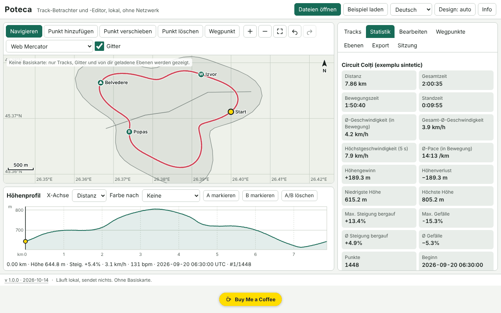

# Poteca — Betrachter und Editor für GPX-Tracks

[English](README.md) · [Română](README.ro.md) · [Français](README.fr.md) · [Italiano](README.it.md) · [Español](README.es.md) · [Português](README.pt.md) · **Deutsch** · [Magyar](README.hu.md)

**Version:** 2.1.0 · **Zuletzt aktualisiert:** 2026-10-27

**Status:** stabil · **Offline:** vollständig; Internet nur für die optionale OpenStreetMap-Karte nötig (standardmäßig aus)

Oberflächensprachen: **Română, English, Français, Italiano, Español, Português (PT), Deutsch, Magyar**

Poteca öffnet GPX-, GeoJSON-, KML- und CSV-Tracks, zeigt sie auf einer lokalen Karte (standardmäßig ohne Basiskarte) an, berechnet Statistiken (Strecke, Anstieg/Abstieg, Zeit in Bewegung und im Stand, Geschwindigkeiten, Steigungen, Runden pro Kilometer/Meile), zeigt ein interaktives, mit der Karte synchronisiertes Höhenprofil und ermöglicht es, Tracks zu bearbeiten (zuschneiden, teilen, zusammenführen, umkehren, vereinfachen, GPS-Sprünge entfernen, manuelle Punkte, Wegpunkte) und zu exportieren. Alles läuft im Browser, offline.

Der Screenshot zeigt synthetische Demodaten („Beispiel laden“), die lokal erzeugt wurden; es sind keine echten Tracks.

**Online-Anwendung:** https://chiuta.github.io/apps/Poteca/

## Verwendung

1. **Dateien öffnen** (oder auf die Seite ziehen): mehrere Dateien gleichzeitig. Das Importprotokoll sagt, was gelesen und was ignoriert wurde und warum.
2. Reiter **Tracks**: Sichtbarkeit, Farbe, Name, Löschen. **Statistiken**: die Werte, der Unterschied zwischen geglättetem und rohem Anstieg, die Rundentabelle (km oder Meilen) und die Segmenttabelle. Die Parameter (Glättung, Anstiegsschwelle, Stillstandsschwelle) können geändert werden.
3. **Karte**: Mausrad / Pinch / `+` `−` zum Zoomen, Ziehen oder Pfeiltasten zum Verschieben, `0` zum Einpassen. Modi: Navigation, Punkt hinzufügen, Punkt verschieben, Punkt löschen, Wegpunkt.
4. **Profil**: Klick oder Pfeiltasten (Umschalt = großer Schritt) bewegen den Cursor, synchron mit der Karte; Färbung nach Steigung, Geschwindigkeit oder Puls; A und B markieren zum Zuschneiden/Extrahieren/Teilen.
5. Reiter **Bearbeiten**: Zuschneiden auf einen Bereich, Teilen, Zusammenführen, Umkehren, Vereinfachung nach Douglas–Peucker (mit vorab angezeigter resultierender Punktzahl), Entfernen von GPS-Sprüngen, Zeitversatz, Vergleich zweier Tracks.
6. Reiter **Ebenen**: eigene GeoJSON-Ebenen und georeferenzierte Bilder (Bild + 2 Passpunkte oder manueller Rahmen).
7. Reiter **Export**: GPX 1.1, GeoJSON, KML, CSV; SVG/PNG für Karte und Profil; Drucken mit Legende; Privatsphäre-Zone (schneidet beim Export die ersten/letzten N Meter ab).
8. Reiter **Sitzung**: Sicherung `.fff.json`, Import, „Alles löschen“.

## Was sie NICHT kann, und Grenzen

- **Standardmäßig keine Basiskarte.** Es werden keine Kacheln heruntergeladen, außer du schaltest die optionale OpenStreetMap-Karte ein (siehe unten). Zu sehen sind nur die Tracks, das adaptive Raster, der Maßstabsbalken und die Ebenen, die Sie selbst laden.
- Hintergrundbilder: PNG/JPEG/WebP mit zwei Passpunkten oder manuellem Rahmen, in der Web-Mercator-Projektion; GeoTIFF wird **nicht** gelesen, die Drehung wird nicht korrigiert.
- Die Anstiegsstatistiken hängen von Glättung und Schwelle ab; die Werte sind Schätzungen (die GPS-Höhe rauscht). Poteca zeigt zum Vergleich auch den Rohwert.
- Die Entfernung wird nach Haversine berechnet (Kugel R = 6.371.008,8 m); Vincenty (WGS84) ist optional und kann um bis zu ~0,3 % abweichen.
- Das Entfernen von Sprüngen ist heuristisch: Prüfen Sie das Ergebnis auf der Karte, bevor Sie speichern.
- Der Vergleich zweier Tracks funktioniert nur auf den gemeinsamen Abschnitten (räumliche Nähe); Zeitunterschiede setzen voraus, dass beide Tracks Zeitangaben haben.
- Sehr große Dateien: 200.000 Punkte (~21 MB GPX) werden in wenigen Sekunden importiert (in unserem Test ≈3 s in der Anwendung), aber die Oberfläche kann bei aufwendigen Operationen kurz hängen (bis ~2 s). GPX-Dateien über ~4 MB werden nicht mehr auf XML-Wohlgeformtheit geprüft; sie werden tolerant gelesen.
- Der Browserspeicher begrenzt die Gesamtzahl der Punkte; eine große Sitzung wird komprimiert in IndexedDB gespeichert (localStorage nur für kleine Sitzungen). Schlägt das Speichern fehl, wird der Status „nicht gespeichert“ angezeigt.
- Keine Datum-Umrechnung, kein MGRS/UTM, keine Straßenrouten und keine Synchronisierung mit GPS-Geräten.
- Die Übersetzungen sind automatisch (siehe unten).

## Datenschutz

Sie läuft lokal und sendet nichts. Die CSP blockiert jede Netzwerkverbindung (`connect-src 'none'`); die einzige Ausnahme ist `img-src` für tile.openstreetmap.org, nur genutzt, wenn du die optionale OpenStreetMap-Karte manuell einschaltest (standardmäßig aus). Ihre Dateien verlassen das Gerät nicht. Lokal gespeichert werden nur die Sitzung (localStorage/IndexedDB, Schlüssel mit dem Präfix `fff.poteca.`) und die Einstellungen (Sprache, Design). „Alles löschen“ entfernt alles. Die Privatsphäre-Zone schneidet beim Export Anfang und Ende des Tracks ab (z. B. um die Wohnadresse nicht zu verraten).

## Unterstützte Formate

- **GPX 1.0 und 1.1**: `trk`/`trkseg`, `rte`, `wpt`; Garmin-TrackPointExtension-Erweiterungen (`hr`, `cad`, `atemp`); Namensraum-Präfixe; ohne `time`/`ele`; abgeschnittenes XML (es wird wiederhergestellt, was möglich ist).
- **GeoJSON** (Point, LineString, MultiLineString, Polygon → Ebene), **KML** (Placemark mit LineString/Point/gx:Track), **CSV** (Trennzeichen und Kopfzeile werden erkannt, Dezimalkomma, Gruppierung nach Track).
- Export: GPX 1.1 (in den Tests mit einem unabhängigen Parser geprüft), GeoJSON, KML, CSV, SVG, PNG.

## Technisches

Eine einzige Datei `index.html`, ohne externe Bibliotheken. Lokale Web-Mercator- und äquirektanguläre Projektionen; Zeichnen auf Canvas, mit demselben Zeichenpfad für SVG/PNG-Export und Druck. Barrierefreies SVG-Profil (Rolle `slider`). Höhenglättung über ein Distanzfenster, Anstieg/Abstieg mit Hysterese, Höchstgeschwindigkeit über ein 5-s-Fenster, iterativer Douglas–Peucker. Sitzung in ganzzahlige Deltas gepackt und gzip-komprimiert. Strenge CSP: `script-src` mit sha256-Hash, kein `eval`, keine Inline-Handler, `connect-src 'none'`; es war keine Lockerung nötig (`worker-src blob:` und `img-src data: blob:` stammen aus der gemeinsamen Vorlage). Die Tests (`tests/test.mjs`, Playwright, Netzwerk gesperrt, CSP aktiv) prüfen Statistiken gegen analytische Werte, GPX/GeoJSON/KML-Round-Trips, die Vereinfachungstoleranz, Barrierefreiheit (axe-core, 0 Verstöße) und die Leistung bei 200.000 Punkten.

## Drittanbieter

Kein Drittanbieter-Code.

## Übersetzungen

Die Oberfläche hat 8 Sprachen: Rumänisch (Standard) und Englisch, vom Autor verfasst; Französisch, Italienisch, Spanisch, Portugiesisch, Ungarisch und Deutsch sind automatische Übersetzungen, nicht von Muttersprachlern geprüft.

## Lizenz

MIT — siehe die Datei `LICENSE` im Wurzelverzeichnis des Repositorys.

## OpenStreetMap-Basiskarte (optional)

Im Tab **Ebenen** gibt es das Kontrollkästchen **OpenStreetMap-Karte anzeigen**.

- **Standardmäßig aus** und **nicht gespeichert**: Bei jedem Öffnen der App ist sie wieder aus. Das Einschalten erfordert eine ausdrückliche Bestätigung.
- **Netzwerkhinweis:** Solange sie an ist, fordert Poteca PNG-Kacheln von 256×256 px von `https://tile.openstreetmap.org/{z}/{x}/{y}.png` an. Der OpenStreetMap-Server sieht deine IP-Adresse, deinen Browser, die anfragende Seite (Referer) und die Kachelkoordinaten (ungefähr Gebiet und Zoomstufe). **Deine Tracks, Wegpunkte und Dateien werden nicht gesendet.**
- CSP: `connect-src 'none'` bleibt unverändert; nur `img-src` erhält `https://tile.openstreetmap.org` (auch in `fff-info`/`app.json`, `egress`, deklariert). Ohne Einschalten stellt die App keine Anfrage.
- Nur in der **Web-Mercator**-Projektion und nur am Bildschirm sichtbar: **nicht in SVG-/PNG-Exporten und im Druck**. Namensnennung auf der Karte: © OpenStreetMap; Daten © OpenStreetMap-Mitwirkende (ODbL). Die Kachelnutzung folgt der [OSM Tile Usage Policy](https://operations.osmfoundation.org/policies/tiles/): nur Kacheln des sichtbaren Bereichs (höchstens 64), kein Massen-Vorabladen; der öffentliche Server kann Anfragen ohne Referer blockieren (z. B. beim Öffnen über `file://`).
- Offline oder bei gesperrtem Netz erscheinen keine Kacheln (eine Fehlermeldung wird angezeigt); der Rest der App funktioniert unverändert.

## Höhenkorrektur mit einem digitalen Geländemodell (DGM): geplant

**Nicht implementiert.** Die GPS-Höhe mit einem DGM (SRTM, Copernicus usw.) zu korrigieren, ist offline in einer einzigen Datei nicht möglich, ohne Geländedaten (zig MB bis GB) einzubetten oder einen zusätzlichen Online-Dienst zu nutzen, der ein zweites Netzwerkziel hinzufügen würde. Es bleibt auf der Roadmap; bis dahin zeigt Poteca den geglätteten Anstieg und den Rohwert und behauptet keine Genauigkeit über die der GPS-Daten hinaus.

## Verlauf
- **2.1.0 — 2026-10-27:** **optionale OpenStreetMap**-Basiskarte (standardmäßig aus, nicht gespeichert, mit Bestätigung und Netzwerkhinweis; nur `img-src` zu tile.openstreetmap.org); Höhenkorrektur per DGM: geplant; Status/Offline-Zeilen; CHANGELOG.md (vorherige: v2.0.0).

- 1.0.0 — 2026-10-14: erste Version.
