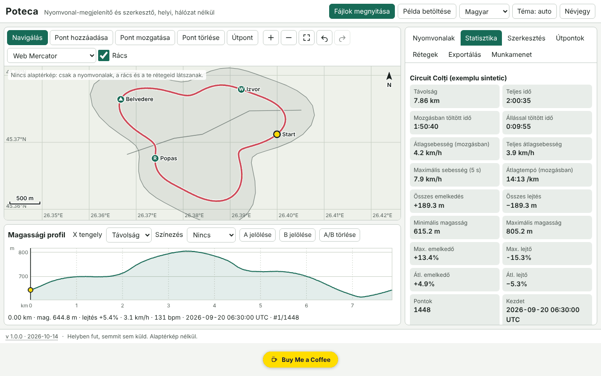

# Poteca — GPX-nyomvonalak megjelenítője és szerkesztője

[English](README.md) · [Română](README.ro.md) · [Français](README.fr.md) · [Italiano](README.it.md) · [Español](README.es.md) · [Português](README.pt.md) · [Deutsch](README.de.md) · **Magyar**

**Verzió:** 2.1.0 · **Utolsó frissítés:** 2026-10-27

**Állapot:** stabil · **Offline:** teljes; internet csak a választható OpenStreetMap-térképhez kell (alapból ki van kapcsolva)

A felület nyelvei: **Română, English, Français, Italiano, Español, Português (PT), Deutsch, Magyar**

A Poteca megnyitja a GPX, GeoJSON, KML és CSV formátumú nyomvonalakat, helyi térképen (alapból alaptérkép nélkül) jeleníti meg őket, statisztikákat számol (távolság, emelkedés/lejtés, mozgással és állással töltött idő, sebességek, lejtőszögek, körök kilométerenként/mérföldenként), a térképpel szinkronizált interaktív magassági profilt mutat, és lehetővé teszi a nyomvonalak szerkesztését (vágás, szétválasztás, egyesítés, megfordítás, egyszerűsítés, GPS-ugrások eltávolítása, kézi pontok, útpontok) és exportálását. Minden a böngészőben fut, offline.

A képernyőkép szintetikus bemutató adatokat mutat („Példa betöltése”), amelyeket helyben állítottunk elő; nem valódi nyomvonalak.

**Online alkalmazás:** https://chiuta.github.io/apps/Poteca/

## Használat

1. **Fájlok megnyitása** (vagy az oldalra húzása): egyszerre több fájl is. Az importnapló megmondja, mit olvasott be, mit hagyott figyelmen kívül, és miért.
2. **Nyomvonalak** fül: láthatóság, szín, név, törlés. **Statisztikák**: az értékek, a simított és a nyers emelkedés különbsége, a körök táblázata (km vagy mérföld) és a szakaszok táblázata. A paraméterek (simítás, emelkedési küszöb, megállási küszöb) módosíthatók.
3. **Térkép**: egérgörgő / csippentés / `+` `−` a nagyításhoz, húzás vagy nyílbillentyűk az eltoláshoz, `0` a kép beállításához. Módok: böngészés, pont hozzáadása, pont áthelyezése, pont törlése, útpont.
4. **Profil**: kattintás vagy nyílbillentyűk (Shift = nagy lépés) mozgatják a kurzort, a térképpel szinkronban; színezés lejtés, sebesség vagy pulzus szerint; az A és B jelölése vágáshoz/kivonáshoz/szétválasztáshoz.
5. **Szerkesztés** fül: vágás intervallumra, szétválasztás, egyesítés, megfordítás, Douglas–Peucker-egyszerűsítés (az eredményül kapott pontszám előzetes megjelenítésével), GPS-ugrások eltávolítása, időeltolás, két nyomvonal összehasonlítása.
6. **Rétegek** fül: saját GeoJSON-rétegek és georeferált képek (kép + 2 illesztőpont vagy kézi keret).
7. **Exportálás** fül: GPX 1.1, GeoJSON, KML, CSV; SVG/PNG a térképhez és a profilhoz; nyomtatás jelmagyarázattal; adatvédelmi zóna (exportáláskor levágja az első/utolsó N métert).
8. **Munkamenet** fül: `.fff.json` biztonsági mentés, importálás, „Mindent töröl”.

## Amit NEM tud, és a korlátok

- **Alapértelmezés szerint nincs alaptérkép.** Nem tölt le csempéket, hacsak nem kapcsolod be a választható OpenStreetMap-térképet (lásd lent). Csak a nyomvonalak, az adaptív rács, a méretarány-sáv és az általad betöltött rétegek látszanak.
- Háttérképek: PNG/JPEG/WebP két illesztőponttal vagy kézi kerettel, Web Mercator vetületben; a GeoTIFF-et **nem** olvassa, a forgatást nem korrigálja.
- Az emelkedési statisztikák a simítástól és a küszöbtől függnek; az értékek becslések (a GPS-magasság zajos). A Poteca összehasonlításképpen a nyers értéket is megmutatja.
- A távolság haversine-képlettel számolódik (gömb, R = 6 371 008,8 m); a Vincenty-féle (WGS84) számítás opcionális, és legfeljebb ~0,3 %-kal térhet el.
- Az ugrások eltávolítása heurisztikus: mentés előtt ellenőrizd az eredményt a térképen.
- Két nyomvonal összehasonlítása csak a közös szakaszokon működik (térbeli közelség); az időbeli különbségekhez mindkét nyomvonalnak tartalmaznia kell időt.
- Nagyon nagy fájlok: 200 000 pont (~21 MB GPX) néhány másodperc alatt importálódik (tesztünkben ≈3 s az alkalmazásban), de a nehéz műveleteknél a felület rövid időre (legfeljebb ~2 s) lefagyhat. A ~4 MB feletti GPX-fájlok XML-jólformáltságát már nem ellenőrzi; megengedően olvassa be őket.
- A böngésző memóriája korlátozza a pontok teljes számát; a nagy munkamenet tömörítve kerül az IndexedDB-be (a localStorage csak kis munkamenetekhez). Ha a mentés sikertelen, a „nincs mentve” állapot jelenik meg.
- Nincs datumátszámítás, MGRS/UTM, közúti útvonaltervezés, sem GPS-eszközökkel való szinkronizálás.
- A fordítások automatikusak (lásd lent).

## Adatvédelem

Helyben fut, és semmit nem küld el. A CSP minden hálózati kapcsolatot blokkol (`connect-src 'none'`); az egyetlen kivétel az `img-src` a tile.openstreetmap.org számára, amelyet CSAK akkor használ, ha kézzel bekapcsolod a választható OpenStreetMap-térképet (alapból ki van kapcsolva). A fájljaid nem hagyják el az eszközt. Helyben csak a munkamenet (localStorage/IndexedDB, `fff.poteca.` előtagú kulcsokkal) és a beállítások (nyelv, téma) kerülnek mentésre. A „Mindent töröl” mindent eltávolít. Az adatvédelmi zóna exportáláskor levágja a nyomvonal elejét és végét (pl. hogy ne áruld el a lakcímedet).

## Támogatott formátumok

- **GPX 1.0 és 1.1**: `trk`/`trkseg`, `rte`, `wpt`; Garmin TrackPointExtension kiterjesztések (`hr`, `cad`, `atemp`); névtér-előtagok; `time`/`ele` nélkül; csonkolt XML (ami menthető, azt helyreállítja).
- **GeoJSON** (Point, LineString, MultiLineString, Polygon → réteg), **KML** (Placemark LineString/Point/gx:Track elemmel), **CSV** (elválasztó és fejléc felismerése, tizedesvessző, csoportosítás nyomvonalanként).
- Export: GPX 1.1 (a tesztekben független elemzővel ellenőrizve), GeoJSON, KML, CSV, SVG, PNG.

## Műszaki részletek

Egyetlen `index.html` fájl, külső könyvtárak nélkül. Helyi Web Mercator és egyenlő távolságú hengervetület; rajzolás canvasra, az SVG/PNG-exportnál és a nyomtatásnál ugyanazzal a rajzolási úttal. Akadálymentes SVG-profil (`slider` szerep). A magasság simítása távolságablakon, emelkedés/lejtés hiszterézissel, maximális sebesség 5 s-os ablakon, iteratív Douglas–Peucker. A munkamenet egész számú deltákba csomagolva, gzip-tömörítéssel. Szigorú CSP: `script-src` sha256-hasht használ, nincs `eval`, nincsenek beágyazott eseménykezelők, `connect-src 'none'`; semmilyen lazításra nem volt szükség (a `worker-src blob:` és az `img-src data: blob:` a közös sablonból származik). A tesztek (`tests/test.mjs`, Playwright, blokkolt hálózat, érvényesített CSP) ellenőrzik a statisztikákat analitikus értékekkel szemben, a GPX/GeoJSON/KML oda-vissza átalakításokat, az egyszerűsítés tűrését, a hozzáférhetőséget (axe-core, 0 szabálysértés) és a teljesítményt 200 000 pontnál.

## Harmadik felek

Nincs harmadik féltől származó kód.

## Fordítások

A felületnek 8 nyelve van: a román (alapértelmezett) és az angol a szerző munkája; a francia, olasz, spanyol, portugál, magyar és német automatikus fordítás, anyanyelvi beszélők nem ellenőrizték.

## Licenc

MIT — lásd a `LICENSE` fájlt a tároló gyökérkönyvtárában.

## OpenStreetMap alaptérkép (választható)

A **Rétegek** fülön található az **OpenStreetMap-térkép megjelenítése** jelölőnégyzet.

- **Alapértelmezés szerint ki van kapcsolva** és **nem mentődik**: az alkalmazás minden megnyitásakor újra ki van kapcsolva. A bekapcsolás kifejezett megerősítést kér.
- **Hálózati figyelmeztetés:** amíg be van kapcsolva, a Poteca 256×256 px-es PNG csempéket kér a `https://tile.openstreetmap.org/{z}/{x}/{y}.png` címről. Az OpenStreetMap szervere látja az IP-címedet, a böngésződet, a kérést indító oldalt (Referer) és a csempék koordinátáit (nagyjából a területet és a nagyítási szintet). **A nyomvonalaid, útpontjaid és fájljaid nem kerülnek elküldésre.**
- CSP: a `connect-src 'none'` változatlan; csak az `img-src` kapja meg a `https://tile.openstreetmap.org` címet (az `fff-info`/`app.json` `egress` mezőjében is szerepel). Bekapcsolás nélkül az alkalmazás nem küld kérést.
- Csak **Web Mercator** vetületben és csak a képernyőn látszik: **nincs benne az SVG/PNG exportban és a nyomtatásban**. Forrásmegjelölés a térképen: © OpenStreetMap; az adatok © az OpenStreetMap közreműködői (ODbL). A csempék használata az [OSM csempehasználati irányelvét](https://operations.osmfoundation.org/policies/tiles/) követi: csak a látható terület csempéi (legfeljebb 64), tömeges előtöltés nélkül; a nyilvános szerver blokkolhatja a Referer nélküli kéréseket (pl. `file://` megnyitásakor).
- Offline vagy blokkolt hálózat esetén a csempék nem jelennek meg (hibaüzenet látszik); az alkalmazás többi része változatlanul működik.

## Magasságkorrekció digitális domborzatmodellel (DEM): tervezett

**Nincs megvalósítva.** A GPS-magasság DEM-mel (SRTM, Copernicus stb.) történő korrigálása offline, egyetlen fájlban nem oldható meg terepadatok beágyazása (több tíz MB-tól GB-ig) vagy egy további online szolgáltatás nélkül, ami egy második hálózati célt adna hozzá. Marad a tervek között; addig a Poteca a simított emelkedést és a nyers értéket is mutatja, és nem állít a GPS-adatoknál nagyobb pontosságot.

## Előzmények
- **2.1.0 — 2026-10-27:** **választható OpenStreetMap** alaptérkép (alapból ki, nem mentődik, megerősítéssel és hálózati figyelmeztetéssel; csak `img-src` a tile.openstreetmap.org felé); DEM-es magasságkorrekció: tervezett; Állapot/Offline sorok; CHANGELOG.md (előző: v2.0.0).

- 1.0.0 — 2026-10-14: első verzió.
