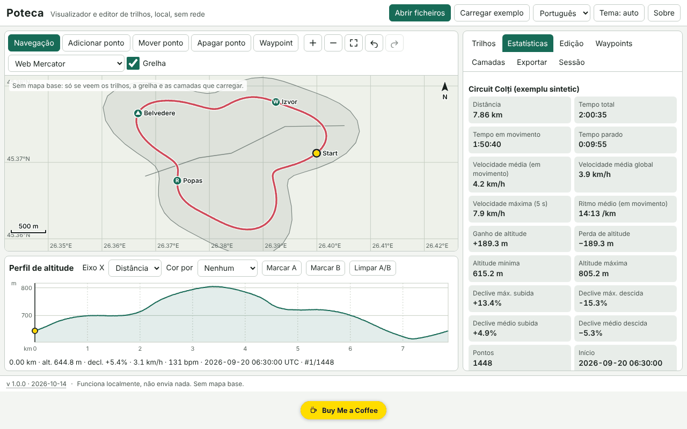

# Poteca — visualizador e editor de percursos GPX

[English](README.md) · [Română](README.ro.md) · [Français](README.fr.md) · [Italiano](README.it.md) · [Español](README.es.md) · **Português** · [Deutsch](README.de.md) · [Magyar](README.hu.md)

**Versão:** 2.1.0 · **Última atualização:** 2026-10-27

**Estado:** estável · **Offline:** completo; requer internet apenas para o mapa OpenStreetMap opcional (desligado por predefinição)

Idiomas da interface: **Română, English, Français, Italiano, Español, Português (PT), Deutsch, Magyar**

O Poteca abre percursos GPX, GeoJSON, KML e CSV, apresenta-os num mapa local (por predefinição sem mapa de base), calcula estatísticas (distância, subida/descida, tempo em movimento e parado, velocidades, declives, voltas por quilómetro/milha), mostra um perfil altimétrico interativo sincronizado com o mapa e permite editar os percursos (cortar, dividir, juntar, inverter, simplificar, eliminar saltos de GPS, pontos manuais, waypoints) e exportá-los. Tudo corre no navegador, offline.

A captura mostra dados de demonstração sintéticos («Carregar exemplo»), gerados localmente; não são percursos reais.

**Aplicação online:** https://chiuta.github.io/apps/Poteca/

## Como se utiliza

1. **Abrir ficheiros** (ou arrastá-los para a página): vários de uma só vez. O registo de importação indica o que foi lido, o que foi ignorado e porquê.
2. Separador **Percursos**: visibilidade, cor, nome, eliminação. **Estatísticas**: os valores, a diferença entre a subida suavizada e a bruta, a tabela de voltas (km ou milhas) e a tabela de segmentos. Os parâmetros (suavização, limiar de subida, limiar de paragem) podem ser alterados.
3. **Mapa**: roda do rato / pinça / `+` `−` para o zoom, arrastar ou setas para deslocar, `0` para enquadrar. Modos: navegação, adicionar ponto, mover ponto, eliminar ponto, waypoint.
4. **Perfil**: clique ou setas (Shift = passo grande) movem o cursor, em sincronia com o mapa; colore por declive, velocidade ou pulsação; marca A e B para cortar/extrair/dividir.
5. Separador **Edição**: corte por intervalo, divisão, junção, inversão, simplificação de Douglas–Peucker (com o número de pontos resultante mostrado previamente), eliminação de saltos de GPS, desfasamento horário, comparação de dois percursos.
6. Separador **Camadas**: camadas GeoJSON próprias e imagens georreferenciadas (imagem + 2 pontos de controlo ou caixa manual).
7. Separador **Exportação**: GPX 1.1, GeoJSON, KML, CSV; SVG/PNG para o mapa e o perfil; impressão com legenda; zona de privacidade (corta os primeiros/últimos N metros na exportação).
8. Separador **Sessão**: cópia de segurança `.fff.json`, importação, «Apagar tudo».

## O que NÃO faz, e limites

- **Sem mapa de base por predefinição.** Não descarrega nenhum mosaico, a não ser que ative o mapa OpenStreetMap opcional (ver abaixo). Veem-se apenas os percursos, a grelha adaptativa, a barra de escala e as camadas que carregar.
- Imagens de fundo: PNG/JPEG/WebP com dois pontos de controlo ou caixa manual, na projeção Web Mercator; o GeoTIFF **não** é lido, a rotação não é corrigida.
- As estatísticas de subida dependem da suavização e do limiar; os valores são estimativas (a altitude GPS tem ruído). O Poteca mostra também o valor bruto para comparação.
- A distância é haversine (esfera R = 6 371 008,8 m); Vincenty (WGS84) é opcional e pode diferir até ~0,3 %.
- A eliminação de saltos é heurística: verifique o resultado no mapa antes de guardar.
- A comparação de dois percursos só funciona nos troços comuns (proximidade espacial); as diferenças de tempo exigem que ambos os percursos tenham hora.
- Ficheiros muito grandes: 200 000 pontos (~21 MB de GPX) importam-se em alguns segundos (no nosso teste, ≈3 s na aplicação), mas a interface pode bloquear brevemente (até ~2 s) nas operações pesadas. Os ficheiros GPX com mais de ~4 MB deixam de ser verificados quanto à boa formação XML; são lidos de forma tolerante.
- A memória do navegador limita o número total de pontos; uma sessão grande é guardada comprimida no IndexedDB (localStorage apenas para sessões pequenas). Se a gravação falhar, é apresentado o estado «não guardado».
- Não tem conversão de datum, MGRS/UTM, percursos rodoviários nem sincronização com dispositivos GPS.
- As traduções são automáticas (ver abaixo).

## Privacidade

Funciona localmente e não envia nada. A CSP bloqueia qualquer ligação de rede (`connect-src 'none'`); a única exceção é `img-src` para tile.openstreetmap.org, usada APENAS se ativar manualmente o mapa OpenStreetMap opcional (desligado por predefinição). Os seus ficheiros não saem do dispositivo. Apenas a sessão (localStorage/IndexedDB, chaves com o prefixo `fff.poteca.`) e as preferências (idioma, tema) são guardadas localmente. «Apagar tudo» elimina tudo. A zona de privacidade corta o início e o fim do percurso na exportação (por ex., para não revelar a morada de residência).

## Formatos suportados

- **GPX 1.0 e 1.1**: `trk`/`trkseg`, `rte`, `wpt`; extensões Garmin TrackPointExtension (`hr`, `cad`, `atemp`); prefixos de espaços de nomes; sem `time`/`ele`; XML truncado (recupera-se o que for possível).
- **GeoJSON** (Point, LineString, MultiLineString, Polygon → camada), **KML** (Placemark com LineString/Point/gx:Track), **CSV** (delimitador e cabeçalho detetados, vírgula decimal, agrupamento por percurso).
- Exportação: GPX 1.1 (verificado nos testes com um analisador independente), GeoJSON, KML, CSV, SVG, PNG.

## Aspetos técnicos

Um único ficheiro `index.html`, sem bibliotecas externas. Projeções locais Web Mercator e equirretangular; desenho em canvas, com o mesmo caminho de desenho para a exportação SVG/PNG e a impressão. Perfil SVG acessível (papel `slider`). Suavização da altitude numa janela de distância, subida/descida com histerese, velocidade máxima numa janela de 5 s, Douglas–Peucker iterativo. Sessão empacotada em deltas inteiros e comprimida com gzip. CSP estrita: `script-src` com hash sha256, sem `eval`, sem manipuladores inline, `connect-src 'none'`; não foi necessário qualquer relaxamento (`worker-src blob:` e `img-src data: blob:` vêm do modelo comum). Os testes (`tests/test.mjs`, Playwright, rede bloqueada, CSP aplicada) verificam as estatísticas face a valores analíticos, os percursos de ida e volta GPX/GeoJSON/KML, a tolerância de simplificação, a acessibilidade (axe-core, 0 violações) e o desempenho com 200 000 pontos.

## Terceiros

Nenhum código de terceiros.

## Traduções

A interface tem 8 idiomas: romeno (predefinido) e inglês, escritos pelo autor; francês, italiano, espanhol, português, húngaro e alemão são traduções automáticas, não verificadas por falantes nativos.

## Licença

MIT — ver o ficheiro `LICENSE` na raiz do repositório.

## Mapa base OpenStreetMap (opcional)

No separador **Camadas** existe a caixa **Mostrar o mapa OpenStreetMap**.

- **Desligado por predefinição** e **não guardado**: sempre que abre a aplicação está de novo desligado. Ativá-lo exige uma confirmação explícita.
- **Aviso de rede:** enquanto estiver ativo, o Poteca pede tesselas PNG de 256×256 px a `https://tile.openstreetmap.org/{z}/{x}/{y}.png`. O servidor do OpenStreetMap vê o seu endereço IP, o seu navegador, a página de onde parte o pedido (Referer) e as coordenadas das tesselas (aproximadamente a área e o nível de zoom). **Os seus trilhos, waypoints e ficheiros não são enviados.**
- CSP: `connect-src 'none'` mantém-se; só `img-src` recebe `https://tile.openstreetmap.org` (declarado também em `fff-info`/`app.json`, `egress`). Sem o ativar, a aplicação não faz nenhum pedido.
- Aparece apenas na projeção **Web Mercator** e só no ecrã: **não surge nas exportações SVG/PNG nem na impressão**. Atribuição no mapa: © OpenStreetMap; dados © os colaboradores do OpenStreetMap (ODbL). O uso das tesselas segue a [política de utilização de tesselas do OSM](https://operations.osmfoundation.org/policies/tiles/): apenas as tesselas da área visível (no máximo 64), sem pré-carregamento em massa; o servidor público pode bloquear pedidos sem Referer (p. ex. ao abrir a partir de `file://`).
- Offline ou com a rede bloqueada as tesselas não aparecem (é mostrada uma mensagem de erro); o resto da aplicação funciona normalmente.

## Correção da altitude com um modelo digital do terreno (MDT): planeado

**Não implementado.** Corrigir a altitude GPS com um MDT (SRTM, Copernicus, etc.) não é possível offline num único ficheiro sem incorporar dados do terreno (de dezenas de MB a GB) nem um serviço online adicional, o que acrescentaria um segundo destino de rede. Fica no plano de desenvolvimento; entretanto, o Poteca mostra a subida suavizada e o valor bruto e não afirma precisão superior à dos dados GPS.

## Histórico
- **2.1.0 — 2026-10-27:** mapa base **OpenStreetMap opcional** (desligado por predefinição, não guardado, com confirmação e aviso de rede; só `img-src` para tile.openstreetmap.org); correção de altitude com MDT: planeado; linhas Estado/Offline; CHANGELOG.md (anterior: v2.0.0).

- 1.0.0 — 2026-10-14: primeira versão.
