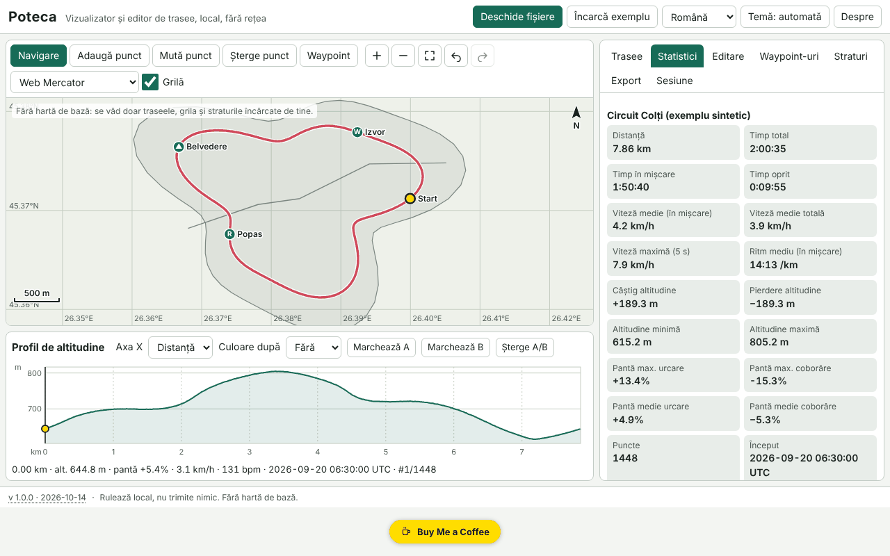

# Poteca — vizualizator și editor de trasee GPX

[English](README.md) · **Română** · [Français](README.fr.md) · [Italiano](README.it.md) · [Español](README.es.md) · [Português](README.pt.md) · [Deutsch](README.de.md) · [Magyar](README.hu.md)

**Versiune:** 2.1.0 · **Ultima actualizare:** 2026-10-27

**Stare:** stabil · **Offline:** complet; cere internet doar pentru harta OpenStreetMap opțională (oprită implicit)

Limbile interfeței: **Română, English, Français, Italiano, Español, Português (PT), Deutsch, Magyar**

Poteca deschide trasee GPX, GeoJSON, KML și CSV, le afișează pe o hartă locală (implicit fără hartă de bază), calculează statistici (distanță, urcare/coborâre, timp în mișcare și oprit, viteze, pante, ture pe kilometri/mile), arată un profil de altitudine interactiv sincronizat cu harta și permite editarea traseelor (tăiere, împărțire, unire, inversare, simplificare, eliminarea săriturilor GPS, puncte manuale, waypoint-uri) și exportul lor. Totul rulează în browser, offline.

Captura arată datele demonstrative sintetice („Încarcă exemplu”), generate local; nu sunt trasee reale.

**Live:** https://chiuta.github.io/apps/Poteca/

## Cum se folosește

1. **Deschide fișiere** (sau trage-le în pagină): mai multe fișiere deodată. Jurnalul de import spune ce s-a citit, ce s-a ignorat și de ce.
2. Fila **Trasee**: vizibilitate, culoare, nume, ștergere. **Statistici**: valorile, diferența dintre urcarea netezită și cea brută, tabelul de ture (km sau mile) și tabelul de segmente. Parametrii (netezire, prag de urcare, prag de oprire) se pot modifica.
   **Analiză (2.0)**: estimare orientativă a duratei după regula lui Naismith (viteză pe orizontală + timp la urcare; corecție Langmuir opțională), distribuția pantelor, segmente abrupte (prag și lungime reglabile, cu „Arată” pe profil, waypoint-uri și export CSV) și compararea a două trasee cu profiluri suprapuse. Totul local; sunt estimări, nu prognoze.
3. **Harta**: roata mouse-ului / ciupire / `+` `−` pentru zoom, tragere sau săgeți pentru deplasare, `0` pentru încadrare. Moduri: navigare, adaugă punct, mută punct, șterge punct, waypoint.
4. **Profilul**: clic sau săgeți (Shift = pas mare) mută cursorul, sincron cu harta; coloreză după pantă, viteză sau puls; marchează A și B pentru tăiere/extragere/împărțire.
5. Fila **Editare**: tăiere la interval, împărțire, unire, inversare, simplificare Douglas–Peucker (cu numărul de puncte rezultat afișat în prealabil), eliminarea săriturilor GPS, decalaj de timp, comparare a două trasee.
6. Fila **Straturi**: straturi GeoJSON proprii și imagini georeferențiate (imagine + 2 puncte de control sau casetă manuală).
7. Fila **Export**: GPX 1.1, GeoJSON, KML, CSV; SVG/PNG pentru hartă și profil; tipărire cu legendă; zonă de confidențialitate (taie primii/ultimii N metri la export).
8. Fila **Sesiune**: copie de siguranță `.fff.json`, import, „Șterge tot”.

## Ce NU face și limitele

- **Implicit nu are hartă de bază.** Nu descarcă nicio dală decât dacă activezi harta OpenStreetMap opțională (vezi mai jos). Se văd doar traseele, grila adaptivă, bara de scară și ce straturi încarci tu.
- Imaginile de fundal: PNG/JPEG/WebP cu două puncte de control sau casetă manuală, în proiecția Web Mercator; **nu** se citește GeoTIFF, nu se corectează rotația.
- Statisticile de urcare depind de netezire și de prag; valorile sunt estimări (altitudinea GPS e zgomotoasă). Poteca arată și valoarea brută pentru comparație.
- Distanța este haversine (sferă R = 6 371 008,8 m); Vincenty (WGS84) este opțional și poate diferi cu până la ~0,3 %.
- Eliminarea săriturilor este euristică: verifică rezultatul pe hartă înainte de a salva.
- Compararea a două trasee funcționează numai pe porțiunile comune (apropiere spațială); diferențele de timp cer ca ambele trasee să aibă timp.
- Fișierele foarte mari: 200.000 de puncte (~21 MB GPX) se importă în câteva secunde (în testul nostru, ≈3 s în aplicație), dar interfața se poate bloca scurt (până la ~2 s) la operațiile grele. Fișierele GPX peste ~4 MB nu mai sunt verificate pentru bună-formare XML; se citesc tolerant.
- Memoria browserului limitează numărul total de puncte; sesiunea mare se salvează comprimat în IndexedDB (localStorage numai pentru sesiuni mici). Dacă salvarea eșuează, se afișează starea „nesalvat”.
- Nu are conversie de datum, MGRS/UTM, rute pe drumuri, sau sincronizare cu dispozitive GPS.
- Traducerile sunt automate (vezi mai jos).

## Confidențialitate

Rulează local, nu trimite nimic. CSP-ul blochează orice conexiune de rețea (`connect-src 'none'`); singura excepție este `img-src` pentru tile.openstreetmap.org, folosită NUMAI dacă activezi manual harta OpenStreetMap opțională (oprită implicit). Fișierele tale nu părăsesc dispozitivul. Se salvează local doar sesiunea (localStorage/IndexedDB, chei cu prefixul `fff.poteca.`) și preferințele (limbă, temă). „Șterge tot” elimină tot. Zona de confidențialitate taie începutul și sfârșitul traseului la export (de ex. pentru a nu dezvălui adresa de domiciliu).

## Formate acceptate

- **GPX 1.0 și 1.1**: `trk`/`trkseg`, `rte`, `wpt`; extensii Garmin TrackPointExtension (`hr`, `cad`, `atemp`); prefixe de spații de nume; fără `time`/`ele`; XML trunchiat (se recuperează ce se poate).
- **GeoJSON** (Point, LineString, MultiLineString, Polygon → strat), **KML** (Placemark cu LineString/Point/gx:Track), **CSV** (delimitator și antet detectate, virgulă zecimală, grupare pe traseu).
- Export: GPX 1.1 (verificat în teste cu un parser independent), GeoJSON, KML, CSV, SVG, PNG.

## Tehnic

Un singur fișier `index.html`, fără biblioteci externe. Proiecții locale Web Mercator și echirectangulară; desen pe canvas, cu aceeași cale de desen pentru exportul SVG/PNG și tipărire. Profil SVG accesibil (rol `slider`). Netezirea altitudinii pe fereastră de distanță, urcare/coborâre cu histerezis, viteză maximă pe fereastră de 5 s, Douglas–Peucker iterativ. Sesiune împachetată în delte întregi și comprimată gzip. CSP strict: `script-src` cu hash sha256, fără `eval`, fără handlere inline, `connect-src 'none'`; nu a fost nevoie de nicio relaxare (`worker-src blob:` și `img-src data: blob:` sunt din șablonul comun). Testele (`tests/test.mjs`, Playwright, rețea blocată, CSP aplicat) verifică statistici față de valori analitice, round-trip-uri GPX/GeoJSON/KML, toleranța simplificării, accesibilitate (axe-core, 0 încălcări) și performanța la 200.000 de puncte.

## Terți

Niciun cod terț.

## Traduceri

Interfața are 8 limbi: română (implicită) și engleză, scrise de autor; franceză, italiană, spaniolă, portugheză, maghiară și germană sunt traduceri automate, neverificate de vorbitori nativi.

## Licență

MIT — vezi fișierul `LICENSE` din rădăcina depozitului.

## Hartă de bază OpenStreetMap (opțională)

În fila **Straturi** există caseta **Afișează harta OpenStreetMap**.

- **Oprită implicit** și **nesalvată**: la fiecare deschidere a aplicației este din nou oprită. Activarea cere o confirmare explicită.
- **Avertisment de rețea:** cât timp e activă, Poteca cere dale PNG de 256×256 px de la `https://tile.openstreetmap.org/{z}/{x}/{y}.png`. Serverul OpenStreetMap vede adresa ta IP, browserul, pagina de pe care s-a cerut (Referer) și coordonatele dalelor (aproximativ zona și nivelul de zoom). **Traseele, waypoint-urile și fișierele tale nu se trimit.**
- CSP: `connect-src 'none'` rămâne neschimbat; doar `img-src` primește `https://tile.openstreetmap.org` (declarat și în `fff-info`/`app.json`, `egress`). Fără activare, aplicația nu face nicio cerere.
- Se vede doar în proiecția **Web Mercator** și doar pe ecran: **nu apare în exporturile SVG/PNG și la tipărire**. Atribuire afișată pe hartă: © OpenStreetMap contributors; datele sunt © contribuitorii OpenStreetMap (ODbL). Folosirea dalelor respectă [Politica de utilizare a dalelor OSM](https://operations.osmfoundation.org/policies/tiles/): doar dalele din zona vizibilă (cel mult 64), fără preîncărcare în masă; serverul public poate bloca cereri fără Referer (de ex. la deschiderea din `file://`).
- Cu rețea blocată sau offline, dalele nu apar (un mesaj de eroare este afișat); restul aplicației funcționează neschimbat.

## Corecția altitudinii cu un model digital al terenului (DEM): planificat

**Neimplementat.** Corectarea altitudinii GPS cu un DEM (SRTM, Copernicus etc.) nu se poate face offline într-un singur fișier fără a încorpora date de teren (zeci de MB până la GB) sau fără un serviciu online suplimentar, ceea ce ar adăuga o a doua destinație de rețea. Rămâne în planul de dezvoltare; între timp, Poteca arată urcarea netezită și valoarea brută și nu pretinde precizie peste cea a datelor GPS.

## Istoric
- **2.1.0 — 2026-10-27:** hartă de bază **OpenStreetMap opțională** (oprită implicit, nesalvată, cu confirmare și avertisment de rețea; doar `img-src` către tile.openstreetmap.org); corecția altitudinii cu DEM: planificat; linii Stare/Offline; CHANGELOG.md (anterior: v2.0.0).

- 1.0.0 — 2026-10-14: prima versiune.
